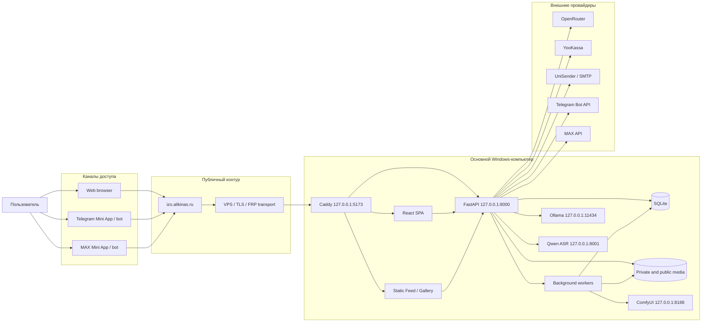
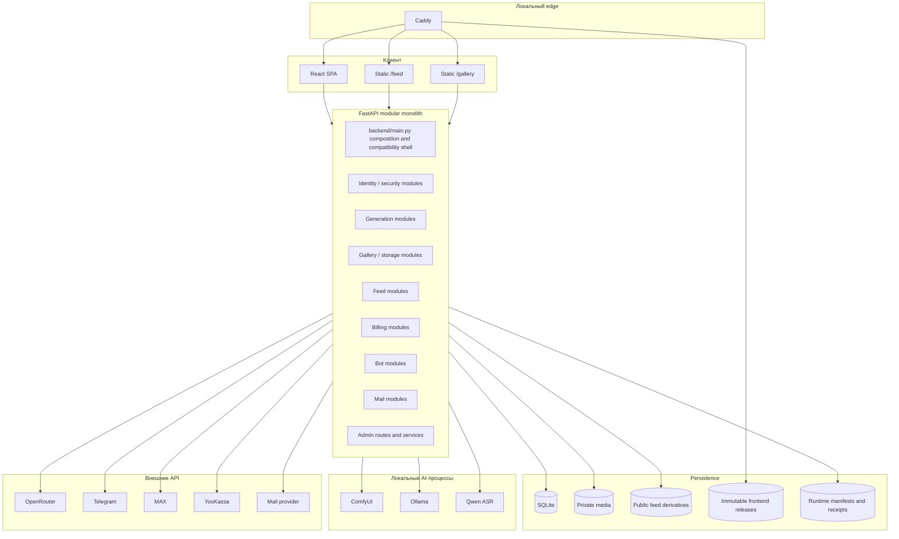
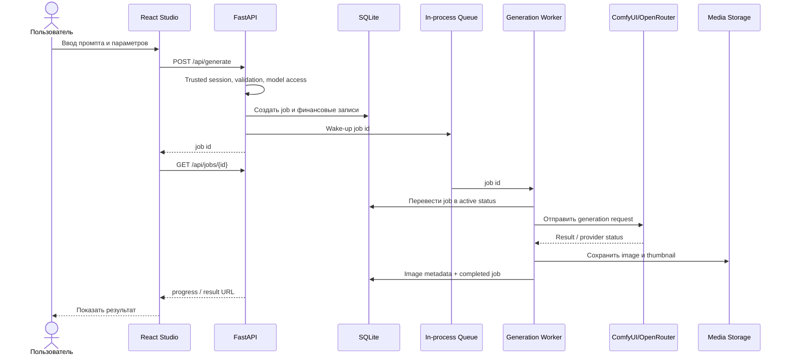
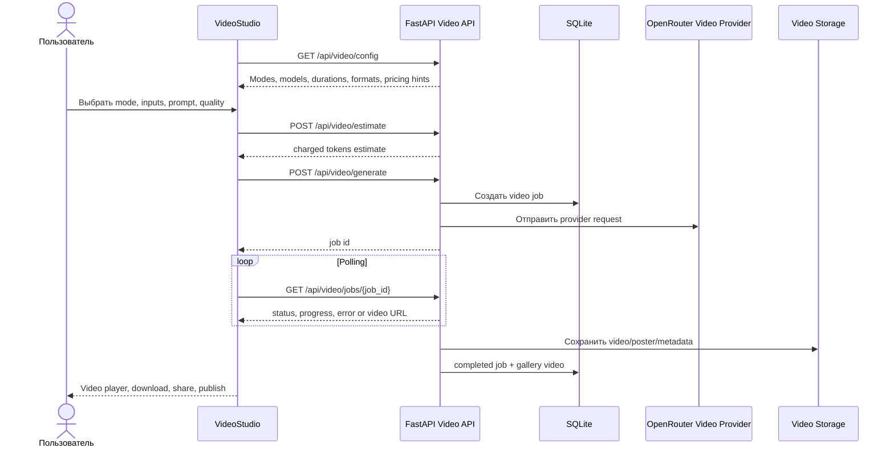
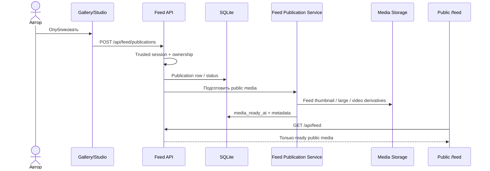
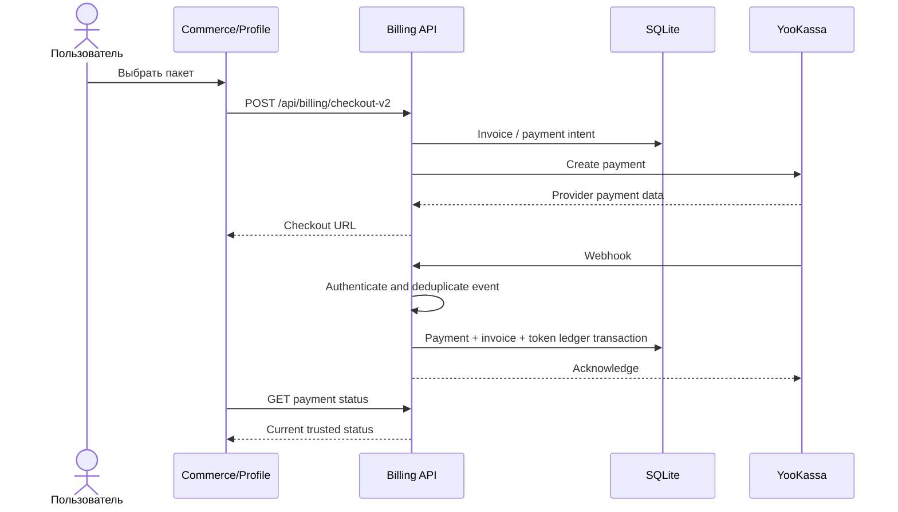
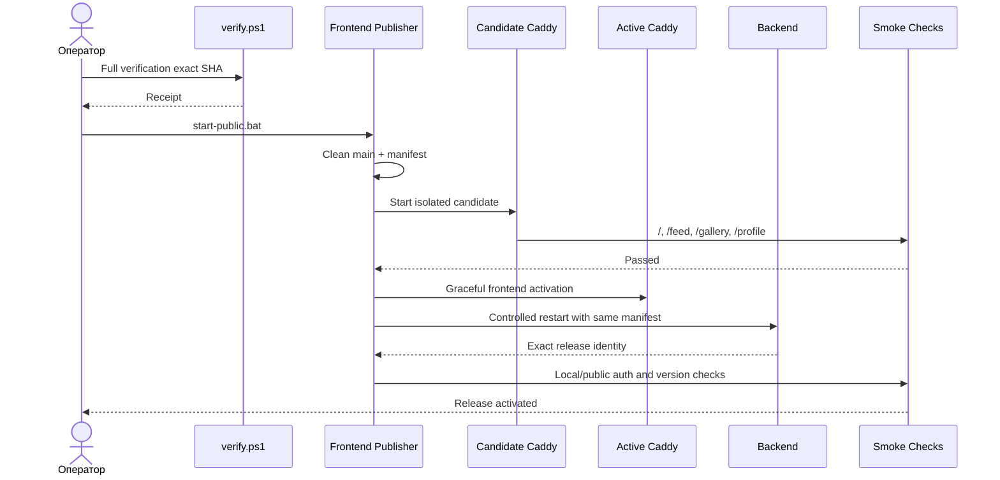
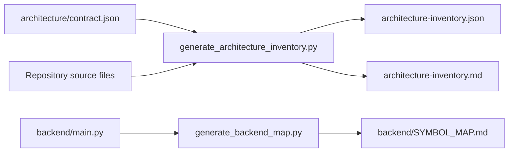

# IZO_ASA — системный обзор архитектуры

- **Тип документа:** human-readable architecture narrative
- **Версия:** `1.0`
- **Статус:** актуализированный source overview; operational-факты требуют отдельного свежего evidence
- **Репозиторий:** `spikeal8-maker/IZO_ASA`
- **Проверенная ветка:** `main`
- **Source baseline перед финальным handoff:** `da104e17b8156fbe86424309bc6850a4b0344caa`
- **Runtime evidence:** read-only preflight 2026-07-22; финальный release фиксируется migration-report
- **Дата актуализации:** 2026-07-22
- **Расположение в репозитории:** `docs/system-overview.md`

> Этот документ объясняет устройство ИЗО АСА человеку. Он не заменяет исходный
> код, `architecture/contract.json`, сгенерированный architecture inventory,
> `backend/SYMBOL_MAP.md`, тесты, release receipt или operational evidence.
>
> Наличие кода в Git означает, что функция реализована в репозитории, но само по
> себе не доказывает, что она развернута и реально работает у внешнего провайдера.
>
> Репозиторий на момент подготовки является приватным. Перед изменением его
> видимости нужен отдельный review: документ консолидирует сведения о локальном
> runtime, listeners, известных ограничениях и каноническом workspace.

---

## Содержание

1. [Назначение документа](#1-назначение-документа)
2. [Краткое резюме системы](#2-краткое-резюме-системы)
3. [Границы достоверности и статусы](#3-границы-достоверности-и-статусы)
4. [Архитектурные решения верхнего уровня](#4-архитектурные-решения-верхнего-уровня)
5. [Контекст системы](#5-контекст-системы)
6. [Контейнеры и исполняемые части](#6-контейнеры-и-исполняемые-части)
7. [Пользовательские поверхности и маршруты](#7-пользовательские-поверхности-и-маршруты)
8. [Frontend-архитектура](#8-frontend-архитектура)
9. [Backend-архитектура](#9-backend-архитектура)
10. [Данные и SQLite](#10-данные-и-sqlite)
11. [Хранение изображений и видео](#11-хранение-изображений-и-видео)
12. [Identity, аутентификация и авторизация](#12-identity-аутентификация-и-авторизация)
13. [Генерация изображений](#13-генерация-изображений)
14. [Режимы работы с изображениями](#14-режимы-работы-с-изображениями)
15. [Генерация видео](#15-генерация-видео)
16. [Галерея](#16-галерея)
17. [Публичная лента](#17-публичная-лента)
18. [Токены, тарифы и платежи](#18-токены-тарифы-и-платежи)
19. [Telegram и MAX](#19-telegram-и-max)
20. [Фоновые процессы и восстановление](#20-фоновые-процессы-и-восстановление)
21. [Внешние интеграции и секреты](#21-внешние-интеграции-и-секреты)
22. [Runtime, сеть и listeners](#22-runtime-сеть-и-listeners)
23. [Сборка, выпуск и rollback](#23-сборка-выпуск-и-rollback)
24. [Резервное копирование и восстановление](#24-резервное-копирование-и-восстановление)
25. [Архитектурная карта и её проверка](#25-архитектурная-карта-и-её-проверка)
26. [Тестирование и доказательства качества](#26-тестирование-и-доказательства-качества)
27. [Текущее состояние и ограничения](#27-текущее-состояние-и-ограничения)
28. [Целевое направление](#28-целевое-направление)
29. [Правила безопасного расширения](#29-правила-безопасного-расширения)
30. [Сопровождение документа](#30-сопровождение-документа)
31. [Приложение A. Источники истины](#приложение-a-источники-истины)
32. [Приложение B. Словарь](#приложение-b-словарь)
33. [Приложение C. Контрольный лист](#приложение-c-контрольный-лист)

---

# 1. Назначение документа

У проекта уже есть подробный технический инвентарь:

- машиночитаемый архитектурный контракт;
- сгенерированная карта маршрутов, процессов, интеграций и крупных файлов;
- карта функций, классов и маршрутов `backend/main.py`;
- планы отдельных подсистем;
- runbook выпуска;
- evidence-аудит;
- правила для агентов.

Технический инвентарь отвечает на вопрос **«что обнаружено в репозитории»**, но не
всегда объясняет:

- что является продуктом как единым целым;
- как пользовательский запрос проходит через систему;
- какие части относятся к одному сценарию;
- где находятся реальные границы ответственности;
- что является текущей архитектурой, а что только целевым планом;
- чем наличие кода отличается от deployment и operational health;
- какие документы главнее других;
- что безопасно менять, а что нельзя трогать без отдельного пакета.

Этот narrative закрывает именно этот разрыв.

## 1.1. Для кого он предназначен

Документ нужен:

- владельцу продукта — для понимания системы без чтения тысяч строк кода;
- разработчику — для определения правильного места изменения;
- UI/UX-дизайнеру — для понимания реальных поверхностей и ограничений;
- специалисту по эксплуатации — для понимания runtime и release boundary;
- аудитору безопасности — для понимания identity, секретов и публичных границ;
- AI-агенту — как обзор после обязательного чтения `AGENTS.md`;
- будущему специалисту, который будет переносить продукт на другой компьютер.

## 1.2. Чего документ не делает

Он не:

- заменяет `AGENTS.md`;
- разрешает deploy, restart, webhook switch или изменение production;
- содержит секреты;
- является исчерпывающей спецификацией каждого API-поля;
- гарантирует operational health внешних сервисов;
- отменяет feature-specific контракты;
- является планом переписывания системы;
- превращает исторические документы в актуальный backlog.

# 2. Краткое резюме системы

ИЗО АСА — работающий генеративный продукт, который объединяет:

- генерацию изображений по тексту;
- преобразование изображения по изображению и промпту;
- сборку результата из нескольких референсов;
- редактор изображения;
- генерацию видео в четырёх режимах;
- приватную галерею;
- публичную ленту;
- профиль и trusted identity;
- тарифы, токены и платежи;
- Telegram Mini App и MAX Mini App;
- администрирование пользователей, моделей, платежей, ботов и почты.

Система работает как **модульный монолит** на одном основном Windows-компьютере.

Основной runtime-контур:

- Caddy принимает локальный frontend edge на `127.0.0.1:5173`;
- FastAPI работает на `127.0.0.1:8000`;
- SQLite хранит прикладное состояние;
- файлы изображений и видео находятся в media-хранилище вне Git;
- генерация использует локальный ComfyUI и внешние модели через OpenRouter;
- Ollama и Qwen ASR используются как локальные AI-сервисы;
- Telegram, MAX, YooKassa и mail-провайдеры подключаются как внешние интеграции;
- VPS не является application server: он используется как транспорт публичного
  домена и TLS/FRP ingress.

Главная архитектурная идея:

> Не переписывать работающий продукт, а последовательно выделять проверенные
> границы внутри модульного монолита, сохраняя данные, поведение пользователей и
> возможность отката.

## 2.1. Система в одном предложении

```text
Web / Telegram / MAX
        ↓
публичный домен и существующий FRP-транспорт
        ↓
локальный Caddy
        ↓
React SPA + статические Feed/Gallery shells
        ↓
FastAPI modular monolith
        ↓
SQLite + private/public media + durable jobs
        ↓
ComfyUI / OpenRouter / Ollama / Qwen ASR / Telegram / MAX / YooKassa / Mail
```

## 2.2. Терминологическая поправка

Первая строка текущего `README.md` всё ещё называет систему prototype. Это не
соответствует production snapshot из evidence-аудита: в системе есть реальные
пользователи, jobs, изображения, публичная лента, платежи, token ledger и боты.
Слово «prototype» следует считать историческим остатком до отдельного обновления
README.

# 3. Границы достоверности и статусы

## 3.1. Разделение состояний

| Статус | Значение |
|---|---|
| `CODE COMPLETE` | Код реализован и прошёл заявленные локальные тесты |
| `DEPLOYED` | Конкретный Git SHA / release ID активирован в production |
| `VERIFIED` | Заявленные acceptance-проверки прошли в указанной среде |
| `OPERATIONALLY VERIFIED` | Реальный пользовательский или provider-flow дал подтверждённый результат |
| `BLOCKED` | Следующий gate невозможен из-за конкретной внешней зависимости |

Пример: наличие Telegram-клиента в Git не доказывает доставку сообщения. Для
такого утверждения нужен реальный provider-flow с timestamp и redacted evidence.

## 3.2. Базовые точки

### Репозиторий

```text
source baseline: da104e17b8156fbe86424309bc6850a4b0344caa
```

Этот baseline включает merge PR #7 (CSRF boundary), #8 (bot decomposition),
#9 (Studio Wave 1) и #10 (сценарий «Оживить»). Финальный SHA после merge этого
документа записывается в `docs/current-machine-handoff-20260722.md`, annotated
handoff tag и внешний `FINAL-MIGRATION-REPORT.md`.

### Runtime evidence

На preflight 2026-07-22 source baseline был новее активного immutable release.
Это означает `CODE COMPLETE`, но ещё не `DEPLOYED`. Точный финальный release ID,
listener ownership и результаты local/public проверок являются динамическим
операционным evidence и фиксируются transfer-отчётом после deploy. Их нельзя
выводить только из наличия кода или HTTP 200.

## 3.3. Иерархия доказательств

От более общего к более сильному:

1. текстовый план;
2. наличие кода;
3. статический анализ;
4. unit/contract test;
5. integration test на временных данных;
6. production build;
7. exact-SHA release receipt;
8. deploy exact SHA;
9. local/public smoke;
10. реальный provider/user flow.

HTTP 200 у оболочки страницы не доказывает, что генерация завершилась, платёж
прошёл, письмо доставлено, бот получил update или мобильный UI не сломан.

# 4. Архитектурные решения верхнего уровня

## ADR-01. Модульный монолит

Система остаётся одним приложением FastAPI с выделяемыми модулями внутри
`backend/app`. Дробление на микросервисы только ради стиля запрещено.

## ADR-02. Один основной Windows-host

Приложение, база, media, backend, локальные AI-сервисы и frontend edge работают
на одном основном Windows-компьютере. Это текущая архитектура, а не вечное
ограничение.

## ADR-03. VPS — транспорт

VPS обслуживает существующий доменный/FRP/TLS-контур. Обычная оптимизация
репозитория не должна менять VPS, DNS или FRP.

## ADR-04. SQLite с одним live writer

Одновременно должен существовать один основной backend writer process против
production SQLite.

## ADR-05. Аддитивные миграции

Схема развивается через versioned migrations и ledger. Повторное использование
версии/имени или изменение checksum применённой миграции запрещено.

## ADR-06. Trusted session поверх legacy identity

`users.id` сохраняется ради совместимости. Каноническая identity строится через
`internal_user_id`, provider identities и server-issued sessions.

## ADR-07. Приватный оригинал и публичная производная — разные сущности

Оригинальная работа пользователя приватна. Публичная лента использует отдельные
оптимизированные derivatives и отдельный publication lifecycle.

## ADR-08. SQLite — источник истины для фоновой работы

In-process queue будит worker, но durable job/publication/payment/mail state
должно переживать restart в SQLite.

## ADR-09. Immutable frontend release

Public frontend строится в отдельный release directory, имеет manifest, Git SHA,
asset hash и release identity.

## ADR-10. Секреты вне Git

Provider tokens и ключи поступают через environment или Windows CurrentUser
DPAPI store вне репозитория.

## ADR-11. Карта генерируется и проверяется

Изменения маршрутов, процессов, listeners, интеграций и архитектурных ограничений
должны отражаться в contract и generated inventory.

## ADR-12. Платформенная миграция только по trigger

Linux, PostgreSQL и внешняя очередь рассматриваются, когда текущий
single-host/SQLite runtime перестаёт удовлетворять измеримым требованиям.

# 5. Контекст системы



## 5.1. Внешние акторы

| Актор | Роль |
|---|---|
| Неавторизованный посетитель | Публичные страницы, вход, ограниченный public API |
| Авторизованный пользователь | Генерация, галерея, профиль, токены, публикации |
| Автор публикации | Управление собственной private/public media lifecycle |
| Администратор | Пользователи, модели, платежи, боты, mail, moderation, diagnostics |
| Telegram | Identity/bootstrap, bot delivery, updates |
| MAX | Identity/bootstrap, bot delivery, updates |
| YooKassa | Платёжные события |
| OpenRouter | Платные модели изображений и видео |
| ComfyUI | Локальная генерация по workflow |
| Оператор Windows-host | Release, backup, provider configuration, recovery |

# 6. Контейнеры и исполняемые части



## 6.1. Таблица контейнеров

| Контейнер | Технология | Ответственность | Persistent state |
|---|---|---|---|
| Caddy edge | Caddy 2.11.4 | Локальная выдача frontend и proxy backend/static routes | Active frontend manifest |
| React application | React, TypeScript, Vite | Студия, редактор, видео, профиль, admin shell | Browser state; server state через API |
| Static feed | HTML/CSS/JS | Канонический публичный `/feed` | Нет собственного durable state |
| Static gallery | HTML/CSS/JS | Канонический пользовательский `/gallery` | Нет собственного durable state |
| FastAPI backend | Python 3.11.9 | API, auth, jobs, billing, bots, storage, publication | SQLite и media |
| SQLite | SQLite | Пользователи, sessions, jobs, media metadata, billing, feed | Файл БД + WAL/SHM |
| Media storage | Файловая система | Private originals, thumbnails, public derivatives, video | Файлы вне Git |
| Generation worker | asyncio task | Обработка generation jobs | Durable job rows + in-memory wake-up |
| Bot workers | asyncio tasks | Telegram/MAX polling | SQLite cursor/marker |
| Feed video worker | asyncio task | Подготовка видео для публичной ленты | Publication state + media |
| ComfyUI | Python / custom workflow | Локальная генерация изображений | Models/workflows вне Git |
| Ollama | Local service | Локальные LLM-задачи | Model store вне Git |
| Qwen ASR | Local service | Распознавание речи | Model/runtime вне Git |
| OpenRouter | External | Платные image/video models | Provider-side |
| YooKassa | External | Checkout, status, webhook, refund | Provider-side + local ledger |
| Mail provider | External | Транзакционные сообщения | Provider-side + local obligations |

# 7. Пользовательские поверхности и маршруты

## 7.1. Канонические маршруты

`frontend/src/App.tsx` определяет текущую маршрутизацию SPA.

| URL | Поверхность | Реализация |
|---|---|---|
| `/` | Основная студия изображений | `NewStudio` / `newUi.tsx` |
| `/paint` | Редактор / рисование | `NewStudio` |
| `/video` | Видеостудия | `NewStudio` + `VideoStudio` |
| `/profile` | Профиль | `NewStudio` / profile component |
| `/admin` | Администрирование | `AdminApp` |
| `/tariffs` | Тарифы | `CommercePage` |
| `/legal/*` и публичные документы | Правовые документы | `CommercePage` |
| `/payment/result` | Результат платежа | `PaymentResultPage` |
| `/feed` | Каноническая лента | Backend static shell |
| `/gallery` | Каноническая галерея | Backend static shell |
| `/old`, `/legacy`, `/v1` | Compatibility UI | `LegacyApp` |

Старые маршруты `/new/*` перенаправляются на канонические пути.

## 7.2. Почему `/feed` и `/gallery` отдельные

Эти поверхности не являются вторым React-приложением. Backend выдаёт свои static
shells:

```text
backend/static/feed/index.html
backend/static/gallery/index.html
backend/static/gallery/gallery.css
backend/static/gallery/gallery.js
```

Следствия:

- SPA build не является полной проверкой Feed/Gallery;
- CSS этих страниц должен быть scoped;
- DOM и behavior тестируются отдельно;
- React не должен создавать второй канонический UI для тех же URL.

## 7.3. Режимы основной студии

Текущая навигация содержит:

- `По тексту`;
- `По фото`;
- `Сборка`;
- `Редактор`;
- `Видео`.

Лента и галерея являются отдельными продуктовыми поверхностями, а не режимами
одной формы генерации.

# 8. Frontend-архитектура

## 8.1. Основные точки входа

Сгенерированная карта фиксирует:

```text
frontend/src/main.tsx
frontend/src/App.tsx
frontend/src/newUi.tsx
frontend/src/LegacyApp.tsx
backend/static/feed/index.html
backend/static/gallery/index.html
```

Дополнительные значимые компоненты:

```text
frontend/src/TopBarV3.tsx
frontend/src/VideoStudio.tsx
frontend/src/ProfilePage.tsx
frontend/src/AdminApp.tsx
frontend/src/authV2.tsx
```

После merge PR #9 (`ARCH-FE-STUDIO-001A`) часть Studio уже вынесена из shell в
малые модули с отдельными обязанностями:

```text
frontend/src/studio/studioApi.ts
frontend/src/studio/studioDraft.ts
frontend/src/studio/studioHelpers.ts
frontend/src/studio/studioImageProcessing.ts
frontend/src/studio/studioNavigation.ts
frontend/src/studio/studioTypes.ts
frontend/src/studio/useStudioState.ts
frontend/src/studio/videoSourceHandoff.ts
```

`newUi.tsx` остаётся большим composition shell; наличие этих seams не означает,
что последующие frontend waves уже выполнены.

## 8.2. Текущий UI shell

`TopBarV3` отвечает за:

- бренд;
- ленту;
- режимы генератора;
- галерею;
- помощь/admin;
- два типа токенов;
- профиль/вход.

Основной экран:

```text
TopBar
  └── layout
      ├── sidebar / composer
      ├── preview-panel / stage
      └── result-dock
          ├── history
          └── prompt/context
```

## 8.3. Почему frontend сложно менять

Крупные файлы baseline:

| Файл | Строк |
|---|---:|
| `frontend/src/newStudioV3.css` | 5 876 |
| `frontend/src/newUi.tsx` | 3 628 |
| `frontend/src/LegacyApp.tsx` | 3 600 |
| `frontend/src/newUi.css` | 3 096 |
| `frontend/src/videoStudio.css` | 2 596 |
| `frontend/src/index.css` | 2 337 |

Сам размер не является ошибкой. Ошибка возникает, когда маленькое изменение
требует затронуть тысячи несвязанных строк.

## 8.4. Целевая frontend-граница

План предусматривает:

- оставить `newUi.tsx` как route/shell composition;
- вынести API hooks;
- вынести bootstrap/session state;
- вынести navigation/layout;
- вынести feature views;
- хранить feature CSS рядом с компонентами;
- оставить responsive rules вместе с соответствующим компонентом;
- не переименовывать массово классы одновременно со split;
- сохранять desktop/mobile visual evidence.

## 8.5. Дизайн-система и текущий дрейф

В проекте есть расхождение:

- основная image studio использует старую палитру и `Inter`;
- video studio уже использует палитру `#070A08`, `#0E1410`, `#354239`, акцент
  `#C7F500` и `Onest`.

Это не runtime-дефект, но визуальная система ещё не полностью унифицирована.
Унификация должна происходить через tokens/components, а не одновременную
массовую замену CSS.

## 8.6. Правильное место UI-дополнения

Новый UI-элемент не должен поставляться как отдельная HTML-страница внутри
продукта.

Например, анимированное пустое состояние:

- реализуется отдельным React-компонентом;
- подключается только в empty branch preview;
- не заменяет loading/result/error;
- использует scoped CSS;
- не меняет global `body`, `button`, `svg`;
- имеет статическую версию при `prefers-reduced-motion`;
- проверяется на desktop и mobile;
- не добавляется непосредственно сотнями строк в `newUi.tsx`.

# 9. Backend-архитектура

## 9.1. Текущее состояние

Backend — FastAPI modular monolith.

Сгенерированная карта source baseline:

- 223 routes;
- 683 top-level functions в `backend/main.py`;
- 78 classes в `backend/main.py`;
- 97 admin routes;
- 55 user routes;
- 60 public/optional/review routes;
- 1 session route;
- 2 webhook routes;
- 8 admin-wrapper routes, требующих ручного review статического детектора.

## 9.2. Роль `backend/main.py`

На практике `backend/main.py` всё ещё содержит значительную часть системы. В
целевой архитектуре он должен стать:

- composition root;
- lifespan wiring;
- router registration;
- dependency wiring;
- временными compatibility adapters.

Новую business logic нельзя добавлять туда без крайней причины.

## 9.3. Уже выделенные seams

- `backend/app/security/*`;
- `backend/app/database/*`;
- `backend/app/storage/*`;
- `backend/app/services/generation_*`;
- `backend/app/services/gallery_*`;
- `backend/app/services/feed_*`;
- `backend/app/services/video_pricing.py`;
- `backend/app/services/bot_admin.py`;
- `backend/app/services/bot_workers.py`;
- `backend/app/services/telegram_updates.py`;
- `backend/app/services/max_updates.py`;
- `backend/app/api/routers/bots_admin.py`;
- `backend/app/api/routers/bots_public.py`;
- `backend/app/integrations/*`;
- `backend/app/billing/*`.

Правильное направление — выделять по одной проверенной ответственности, а не
переносить тысячи строк одним commit.

## 9.4. Крупные API-домены

| Домен | Примеры API |
|---|---|
| Health/release | `/api/health`, `/api/version` |
| Generation | `/api/generate`, `/api/jobs/{id}` |
| Models | `/api/models`, Flux/OpenRouter config |
| Gallery | `/api/gallery/items`, `/api/gallery/{id}` |
| Identity | `/api/auth/*`, `/api/me-v2`, sessions |
| Profile | `/api/me/profile-v2`, devices, consents |
| Billing | `/api/billing/*`, account token history |
| Bots | `/api/platforms`, `/api/bots/*`, Telegram/MAX |
| Video | `/api/video/config`, generate, estimate, history |
| Feed | `/api/feed`, publications, reactions, moderation |
| Admin | users, models, mail, payments, diagnostics |

## 9.5. Авторизационная карта

Статический детектор консервативен. Метка `REVIEW` означает, что authorization
не был распознан простым анализом и должен быть подтверждён кодом, negative test,
reviewed exception и аудитом.

Восемь bot-admin wrappers находятся в `reviewed_routes`, потому что делегируют
provider-specific trusted-admin operation. Это допустимо только при сохранении
соответствующих тестов.

# 10. Данные и SQLite

## 10.1. Общая модель

SQLite хранит:

- identity и sessions;
- пользователей и профиль;
- jobs;
- изображения, источники и видео;
- gallery metadata;
- feed publications и engagement;
- tariffs, tokens, invoices, payments и refunds;
- promo/referral state;
- audit/security/event logs;
- bot polling state;
- настройки и migration ledger.

Media не хранятся как BLOB в SQLite. База содержит metadata и имена файлов.

## 10.2. Логические группы таблиц

### Identity и безопасность

```text
users
auth_identities
auth_sessions
session_events
auth_login_attempts
auth_login_challenges
auth_otp_challenges
auth_passwords
password_reset_challenges
device_installations
user_consents
legal_acceptances
security_events
audit_logs
```

### Генерация и media

```text
jobs
images
images_search
image_sources
videos
video_file_deletions
presets
loras
model_profiles
```

### Лента и social

```text
feed_publications
feed_reactions
feed_author_follows
feed_engagement_events
feed_subscription_reads
feed_view_events
challenges
challenge_entries
```

### Финансовый контур

```text
token_ledger
billing_packages
invoices
invoice_items
payments
refunds
payment_provider_events
payment_notification_outbox
tariff_token_grants
bonus_grants
promo_codes
promo_redemptions
referral_links
referral_relations
referral_rewards
user_billing_profiles
```

### Операционное состояние

```text
schema_migrations
bot_polling_state
admin_settings
admin_secrets
event_logs
```

## 10.3. Количество таблиц и расхождение snapshot

Generated inventory фиксирует 52 application table declarations, включая
виртуальную FTS5-таблицу `images_search`.

Read-only запрос к live SQLite 2026-07-22 зафиксировал 57 таблиц. Разница точно
объясняется пятью штатными FTS5 shadow tables:

```text
images_search_config
images_search_content
images_search_data
images_search_docsize
images_search_idx
```

Это ожидаемая реализация FTS5, а не повреждение или пять независимых application
tables.

## 10.4. Foreign keys

Generated inventory обнаруживает 0 деклараций foreign key.

Логические связи существуют через `user_id`, `internal_user_id`, `job_id`,
`image_id`, `video_id`, `publication_id` и другие поля.

Отсутствие DB-level FK повышает важность transaction boundaries, ownership checks,
lifecycle tests, reconciliation, cleanup journals, negative tests и idempotency.

## 10.5. Миграции

`backend/app/database/migrations.py` содержит:

- таблицу `schema_migrations`;
- version;
- уникальное имя;
- SHA-256 checksum;
- applied timestamp;
- проверку повторного использования имени;
- fail-closed при неизвестной новой версии;
- baseline migration `version=1`;
- безопасные additive-column helpers.

Текущий ledger в основном фиксирует legacy baseline v1. Новые schema changes
должны оформляться как неизменяемые версии v2+.

## 10.6. Правила изменения данных

Запрещено в обычной feature-задаче:

- переписывать production DB;
- копировать открытую SQLite обычным file copy;
- запускать вторую live writer-копию backend;
- менять checksum применённой migration;
- повторно использовать migration version;
- использовать production DB/media как test fixtures;
- массово удалять originals без dry-run, backup и recovery plan.

# 11. Хранение изображений и видео

## 11.1. Media-роли

| Роль | Доступ | Назначение |
|---|---|---|
| Gallery original | Private | Оригинал владельца, download, reuse |
| Gallery thumbnail | Private | Быстрое отображение личной галереи |
| Uploaded source preview | Private | Повторное использование входного материала |
| Feed thumbnail | Public | Плитка ленты |
| Feed large | Public | Detail-представление |
| Video original | Private | Пользовательский ролик |
| Video poster/preview | По lifecycle | Карточки и публикация |

## 11.2. Privacy-инвариант

Публичная лента не должна отдавать private original напрямую.

Publication создаёт отдельные оптимизированные derivatives. Это позволяет удалить
EXIF, ограничить размер, сохранить aspect ratio, не раскрывать private URL и
независимо управлять publication lifecycle.

## 11.3. Удаление и lifecycle

Manual delete оригинала:

- освобождает gallery slot;
- удаляет/помечает private gallery media;
- требует обработки связанных publications;
- не должен произвольно удалять независимую uploaded-source library.

В документации gallery и feed есть исторически разные формулировки о сохранении
public derivatives после auto-eviction и retirement после manual delete. При
изменении lifecycle current tests и service code являются главным источником, а
оба документа обновляются вместе.

## 11.4. Aspect ratio

Backend хранит и отдаёт width/height, native aspect ratio, orientation, source
type и display policy. Gallery picker, grid, feed card и detail должны сохранять
различимость portrait, landscape, square и custom formats.

# 12. Identity, аутентификация и авторизация

## 12.1. Переходная identity-модель

### Legacy identity

```text
users.id = telegram_xxx / max_xxx / web_xxx
```

Она остаётся связанной с историческими jobs, images и token ledger.

### Canonical identity

```text
users.internal_user_id
auth_identities
auth_sessions
```

Один пользователь может связать несколько provider identities с одним
`internal_user_id`.

## 12.2. Trusted session

Защищённые v2 routes должны разрешать пользователя по server-issued session, а не
по client-controlled header/cookie.

Токен сессии:

- не хранится в базе в открытом виде;
- проверяется сервером;
- имеет expiry;
- может быть отозван;
- связан с session events;
- используется для trusted admin role.

## 12.3. Provider identity

Поддерживаемые каналы:

- web email/password;
- email OTP;
- Telegram strict auth;
- MAX strict auth;
- bot-login flow;
- linking providers.

## 12.4. Legacy compatibility

Architecture contract регистрирует пять legacy consumers:

- `request_user_id` читает `X-OneNode-User`;
- `request_user_id` читает `onenode_user`;
- legacy bootstrap устанавливает cookie;
- web login удаляет obsolete cookie;
- permissions helper читает header для аудита spoof attempt после trusted
  resolution.

Наличие allowlist не является доказательством безопасности. Для закрытия
legacy-auth нужны route-by-route negative tests и последовательное удаление.

## 12.5. Admin

Admin route должен:

- требовать trusted session;
- проверять role;
- не полагаться на наличие ссылки в UI;
- писать audit event при mutation;
- не возвращать provider secrets;
- не логировать auth material.

## 12.6. Cookie environment

Public HTTPS:

```text
Secure=true
SameSite=None
```

Local HTTP:

```text
Secure=false
SameSite=lax
```

Ослабляется только transport policy для localhost/127.0.0.1, а не identity
validation.

## 12.7. Исторический identity plan

`docs/identity-core-plan.md` описывает исходную проблему и фазовый migration plan.
Часть его формулировок уже историческая: trusted sessions и многие таблицы
реализованы.

Его нельзя использовать как точное описание текущего состояния без сверки с
`AGENTS.md`, generated inventory, current auth code, audit и tests.

# 13. Генерация изображений

## 13.1. Основной сценарий



## 13.2. Durable и ephemeral части

Durable:

- job row;
- user binding;
- status;
- progress;
- request/settings;
- token transaction/refund state;
- resulting image row;
- media file.

Ephemeral:

- asyncio queue;
- in-process progress cache;
- active task handle.

Источник истины — persisted state, а не очередь.

## 13.3. Restart recovery

Recovery рассматривает active statuses:

```text
queued
running
uploading
sent_to_comfyui
sent_to_openrouter
```

При startup reconciliation:

- если active image уже сохранено, job завершается как completed;
- если результата нет, job переводится в failed;
- токены возвращаются через idempotent refund path;
- операция выполняется transactionally.

Restart не должен бесконечно оставлять jobs в active состоянии и не должен
возвращать токены дважды.

## 13.4. Cancellation

`POST /api/jobs/{job_id}/cancel` существует как user route. Нельзя обещать
мгновенную остановку внешней операции, если provider уже принял запрос.
Финансовая логика остаётся идемпотентной.

## 13.5. Provider boundary

### ComfyUI

Backend:

- проверяет локальный endpoint;
- использует workflow;
- патчит inputs;
- отправляет `/prompt`;
- опрашивает `/history/{prompt_id}`;
- скачивает через `/view`;
- сохраняет локальную копию.

### OpenRouter

Backend:

- получает catalog/model data;
- использует скрытый API key;
- считает стоимость;
- не раскрывает technical model filename обычному пользователю;
- сохраняет provider billing metadata для reconciliation.

# 14. Режимы работы с изображениями

## 14.1. По тексту

Вход:

- prompt;
- style/template;
- aspect ratio;
- resolution/quality;
- model preset.

Выход:

- image;
- thumbnail;
- job metadata;
- prompt/settings snapshot;
- gallery item при наличии slot.

## 14.2. По изображению

Входы остаются раздельными:

- исходное изображение;
- текстовая инструкция;
- influence/strength;
- model/settings.

UI поддерживает загрузку файла, выбор из галереи, последний источник, preview,
удаление и slider влияния.

## 14.3. Сборка

Текущая модель шире, чем только «человек + худи + брюки + обувь».

Есть:

- основа;
- несколько reference slots;
- роли источников;
- face-specific controls;
- strength.

Наглядный UI-пример может показывать одежду, но архитектура сохраняет
универсальность reference roles.

## 14.4. Редактор

Редактор включает sketch, mask, outpaint, remove background и другие image tools.
Он использует drawing tools и Konva/canvas state.

Изменения редактора должны проверяться не только layout-тестом, но и реальным
изменением canvas.

## 14.5. Reuse

Галерея и uploaded source library поддерживают use-as. Выбор источника применяется
к точному slot, который открыл picker.

# 15. Генерация видео

## 15.1. Четыре режима

`VideoStudio.tsx` фиксирует:

```text
text_to_video
image_to_video
first_last_frame
reference_to_video
```

Пользовательские названия:

- Текст → видео;
- Изображение → видео;
- Начало и конец;
- По референсам.

## 15.2. API

```text
GET  /api/video/config
POST /api/video/estimate
POST /api/video/generate
GET  /api/video/jobs/{job_id}
GET  /api/video/history
GET  /api/video/media/{job_id}
```

## 15.3. Сценарий



## 15.4. «Оживить» из изображения

PR #10 добавил в source baseline безопасный вход в `image_to_video` из основной
Studio и приватной Gallery:

1. пользователь нажимает «Оживить» у выбранного изображения;
2. Gallery подтверждает owner-checked источник через
   `POST /api/gallery/{id}/use-as`;
3. краткоживущий handoff версии 1 записывается в `sessionStorage`;
4. браузер переходит на `/video`;
5. `videoSourceHandoff.ts` валидирует payload, а `VideoStudio` выбирает
   `image_to_video` и показывает исходник.

Сам переход не вызывает `POST /api/video/generate`, не обращается к платному
provider и не списывает токены. Генерация начинается только отдельным действием
пользователя. Это `CODE COMPLETE` для baseline; `DEPLOYED` и live UI evidence
фиксируются отдельно для конкретного release.

## 15.5. Pricing

Video pricing использует:

1. provider catalog SKU;
2. compatible catalog key;
3. фактическую историю стоимости того же model/mode/resolution;
4. cohort history;
5. conservative startup baseline.

Fallback помечается source, fallback flag, sample count и pricing key.

## 15.6. Result lifecycle

Готовый ролик:

- сохраняется в history;
- может попасть в gallery;
- имеет duration/aspect/resolution/audio metadata;
- может быть опубликован в feed;
- для public feed создаются poster/preview/full derivatives.

## 15.7. Empty, progress и history

UI различает:

- нет результата;
- job in progress;
- completed video;
- failed/cancelled/expired;
- выбранная старая job;
- активная job, пока пользователь смотрит history.

Empty illustration должна существовать только в ветке «нет job».

# 16. Галерея

## 16.1. Каноническая реализация

Пользовательская `/gallery` принадлежит static gallery shell, а не старому React
gallery view.

## 16.2. Gallery slots

Slots зависят от тарифа и считаются по active images.

Правила:

- favorite защищает original от auto-eviction;
- при заполнении удаляется старейший non-favorite;
- если все slots защищены favorite, результат job возвращается пользователю, но
  не сохраняется как gallery item;
- manual delete освобождает slot;
- uploaded source library имеет отдельный lifecycle.

## 16.3. Gallery API

```text
GET    /api/gallery/items
GET    /api/gallery/secondary
GET    /api/gallery/page
GET    /api/gallery/{image_id}
POST   /api/gallery/{image_id}/favorite
DELETE /api/gallery/{image_id}
POST   /api/gallery/{image_id}/use-as
```

## 16.4. Media access

Private media owner-checked, связана с active DB row и не должна быть доступна по
простому guessed filename. Missing physical file возвращает явную ошибку.

## 16.5. UI-инварианты

- newest first в normal reading order;
- server-side search/filter;
- cursor pagination;
- aspect-ratio-aware cards;
- не использовать CSS columns для порядка;
- fullscreen viewer;
- in-page confirm modal;
- mobile layout без дублирования actions.

# 17. Публичная лента

## 17.1. Назначение

Лента — не просто публичная галерея.

```text
Лента → Remix / use-as → Генерация → Публикация
```

Feed payload должен содержать source type, aspect ratio, author, prompt
visibility, remix policy, media status, category/tags и generation snapshot.

## 17.2. Publication flow



## 17.3. Public derivatives

Public feed:

- не читает original на лету;
- не делает compression на GET;
- не подставляет private original при missing derivative;
- отдаёт только ready media;
- сохраняет native aspect ratio;
- удаляет metadata/EXIF;
- использует WebP для изображений.

## 17.4. Seed content

Стартовое editorial feed хранится как versioned bundle:

```text
backend/seed/feed/manifest.json
backend/seed/feed/*.webp
backend/app/database/demo_feed.py
backend/restore_demo_feed_bundle.py
```

Production DB и полный media tree не коммитятся.

## 17.5. Engagement и moderation

Система содержит likes/dislikes, saves, views, hides, reports, follows,
challenges и admin moderation.

Public/optional authorization routes требуют особенно внимательных privacy и
abuse tests.

# 18. Токены, тарифы и платежи

## 18.1. Финансовый контур является production

Существуют реальные:

- token ledger;
- billing packages;
- invoices;
- payments;
- provider events;
- refunds;
- tariff grants;
- promo;
- referrals;
- bonus grants.

Token balance нельзя рассматривать как декоративный UI counter.

## 18.2. Платёжный поток



## 18.3. Инварианты

- provider event idempotent;
- amount/currency/package/user binding проверяются server-side;
- повторный webhook не начисляет токены второй раз;
- admin simulation отделяется от real provider;
- refund использует единый financial path;
- automated tests не выполняют real charge/refund;
- ledger изменяется transactionally;
- manual admin action аудируется.

## 18.4. Направление

Billing modules существуют, но master plan предусматривает дальнейшую
консолидацию financial transaction boundary в `BILL-001`.

# 19. Telegram и MAX

## 19.1. Что находится в Git

В Git находятся:

- Telegram HTTP client;
- MAX HTTP client;
- health probes;
- update handlers;
- polling workers;
- webhook routes;
- admin configuration helpers;
- auth flows;
- bot-login flows;
- tests;
- architecture registrations.

Реальных tokens в Git нет.

После merge PR #8 bot subsystem имеет явные модульные границы:

| Ответственность | Модуль |
|---|---|
| Public/webhook routes | `backend/app/api/routers/bots_public.py` |
| Trusted admin routes | `backend/app/api/routers/bots_admin.py` |
| Admin operations | `backend/app/services/bot_admin.py` |
| Polling owner/runtime | `backend/app/services/bot_workers.py` |
| Telegram update handling | `backend/app/services/telegram_updates.py` |
| MAX update handling | `backend/app/services/max_updates.py` |
| Provider transports | `backend/app/integrations/telegram.py`, `max_client.py` |

`backend/main.py` остаётся composition/compatibility shell и связывает эти
компоненты, но новая bot business logic не должна возвращаться в него.

## 19.2. Режимы доставки

```text
disabled
polling
webhook
```

Для каждого provider должен существовать ровно один delivery owner. Нельзя
одновременно держать polling и webhook без безопасного handoff protocol.

## 19.3. Telegram

Telegram client:

- вызывает Bot API;
- классифицирует HTTP/API/JSON errors;
- не включает token в exception text;
- читает `retry_after`;
- выполняет sanitized `getMe` probe.

Polling state:

- хранит cursor в SQLite;
- возобновляется после restart;
- имеет bounded retry;
- не имеет независимого supervisor.

Webhook:

- требует secret;
- проверяет secret header;
- ограничивает body;
- подавляет duplicate update id в bounded cache;
- не включается автоматически при polling mode.

## 19.4. MAX

MAX client:

- валидирует token/base URL;
- вызывает API;
- использует configured trust store;
- классифицирует transport и response errors;
- имеет sanitized `/me` probe;
- не включает token или полный secret URL в error.

Polling marker хранится в SQLite.

## 19.5. Operational status

На audit snapshot:

- MAX имел более сильное runtime evidence;
- Telegram показывал повторяющийся `TelegramTransportError`;
- наличие token/config не считалось operational health.

Корректный health включает last successful cycle, last failure, classified error,
cursor/marker, retry state, delivery mode и owner process.

## 19.6. Bot admin

Trusted admin UI управляет mode, polling, token, verify, webhook secret, webhook
setup/deletion и URLs.

Public status должен быть минимальным. Provider diagnostics остаются только в
trusted-admin API.

# 20. Фоновые процессы и восстановление

## 20.1. Workers

| ID | Owner | Durable state | Recovery | Watchdog |
|---|---|---|---|---|
| `generation-consumer` | `backend.app.services.generation_queue` | SQLite jobs + in-process wake-up | `generation_recovery` | отсутствует |
| `telegram-polling` | `backend.main` | SQLite cursor | resume after restart | bounded retry, без независимого supervisor |
| `max-polling` | `backend.main` | SQLite marker | resume after restart | bounded retry, без независимого supervisor |
| `feed-video-publication` | `backend.main` | publication status + queue | requeue `preparing` | отсутствует |

## 20.2. Ephemeral tasks

| ID | Назначение | Durable result | Watchdog |
|---|---|---|---|
| `avatar-cache` | Кеширование avatar | Файл + metadata | not applicable |
| `openrouter-catalog-refresh` | Обновление process cache | process cache | single task handle |
| `gallery-storage-optimization` | Startup maintenance | SQLite + files | отсутствует |
| `runtime-alert` | Отправка webhook alert | external only | отсутствует |

## 20.3. Почему in-process worker пока допустим

Текущий runtime использует один application host/process writer. SQLite является
durable source. Внешняя очередь не нужна, пока нет нескольких application hosts,
измеренного contention или сложных scheduling semantics.

## 20.4. Что усилить

- persistent leasing;
- last-success health;
- watchdog;
- controlled retry;
- dead job recovery;
- idempotent side effects;
- crash/reboot rehearsal;
- process supervisor;
- single-flight release/verification lock.

# 21. Внешние интеграции и секреты

## 21.1. Интеграции

| Интеграция | Локальный adapter | Secret source |
|---|---|---|
| ComfyUI | `backend/app/integrations/comfyui_client.py` | Нет secret |
| Ollama | `backend/app/integrations/ollama.py` | Нет secret |
| Qwen ASR | `backend/app/integrations/qwen_asr.py` | Нет secret |
| OpenRouter | `backend/app/integrations/openrouter.py` | DPAPI / environment |
| Telegram | `backend/app/integrations/telegram.py` | DPAPI / environment |
| MAX | `backend/app/integrations/max_client.py` | DPAPI / environment |
| YooKassa | `backend/app/integrations/yookassa.py` | DPAPI / environment |
| SMTP | `backend/app/integrations/smtp.py` | DPAPI / environment |
| Runtime alert | `backend/main.py` | Environment configuration |
| FRP transport | external config | Вне репозитория |

Mail architecture также содержит UniSender adapter, но operational delivery
доказывается отдельно.

## 21.2. Secret policy

Секреты запрещены в Git, issue/PR text, screenshots, logs, client responses, test
snapshots, release manifest, generated inventory и chat.

## 21.3. DPAPI

Windows CurrentUser DPAPI:

- привязан к Windows account;
- не является переносимым backup;
- на новом PC требует повторного ввода или rotation;
- не должен запускаться под `SYSTEM`, если production secrets принадлежат user
  account.

## 21.4. Provider tests

Автоматические тесты используют fake adapters. Они не должны расходовать
OpenRouter, отправлять реальные письма, менять webhook, получать реальные bot
updates, проводить charge/refund или менять provider configuration.

# 22. Runtime, сеть и listeners

## 22.1. Listeners

| Роль | Bind | Port | Required |
|---|---|---:|---:|
| Frontend edge | `127.0.0.1` | 5173 | да |
| FastAPI | `127.0.0.1` | 8000 | да |
| Qwen ASR | `127.0.0.1` | 8001 | опционально |
| ComfyUI | `127.0.0.1` | 8188 | опционально по профилю |
| Ollama | целевой loopback | 11434 | опционально |

## 22.2. Caddy

Caddy:

- выдаёт immutable frontend release;
- proxy `/api`, `/media`, `/feed`, `/gallery`, `/static`;
- включает compression;
- задаёт security headers;
- обслуживает hashed assets с long cache;
- HTML выдаёт `no-store`;
- удаляет или hash-ит sensitive log fields;
- проверяется pinned binary/config contract.

## 22.3. VPS/FRP

```text
izo.alikinas.ru
    → VPS TLS/FRP ingress
    → локальный 127.0.0.1:5173
    → Caddy
```

Обычная feature-задача не должна менять этот контур.

## 22.4. Ollama warning

Audit наблюдал Ollama на IPv6 wildcard. Contract пока допускает warning.

Нужно либо enforce loopback, либо доказать firewall boundary.

# 23. Сборка, выпуск и rollback

## 23.1. Канонический workspace

```text
D:\Google Drive\My progact\Генератор картинок
```

Нельзя выпускать из временной копии, attachment, sibling folder, случайного
worktree или symlink target без проверки.

## 23.2. Launchers

| Launcher | Назначение |
|---|---|
| `start-project.bat` | Local development |
| `start-public.bat` | Controlled public release |
| `start-public-autostart.bat` | Release/startup + FRP verification |
| `stop-public.bat` | Stop local public processes |

Public domain не должен отдавать Vite dev server.

## 23.3. Immutable frontend release

Каждый candidate:

```text
.runtime/releases/frontend/<release_id>
```

Manifest содержит release ID, full Git SHA, `dirty=false`, UTC build time,
frontend asset count/hash, Python/Node versions и schema compatibility.

## 23.4. Release flow



## 23.5. Известная граница

Frontend immutable. Backend пока загружается из mutable checkout. Backend A/B
slots, immutable API artifact, request drain и exact old-backend rollback остаются
`REL-002`.

## 23.6. Single-flight ownership

Исторический audit воспроизвёл одновременный запуск двух publishers/full
verification. В source baseline этот gap закрыт
`tools/repository-operation-lock.ps1`: `public-release` и `full-verify` используют
атомарный lock и fail closed при занятой операции.

Операционное правило остаётся тем же:

- один release owner;
- нельзя запускать второй Full;
- нельзя параллельно запускать publisher/restart;
- свободный CPU не является разрешением на concurrent release.

# 24. Резервное копирование и восстановление

## 24.1. Что входит

Штатный production backup покрывает ровно два источника пользовательских данных:

1. SQLite через `sqlite3.Connection.backup()` с integrity/checksum validation;
2. полное предусмотренное runbook дерево media через content-addressed objects и
   manifest.

Runtime/audit artifacts, Git, программы, модели и secrets в этот snapshot не
входят; migration package переносит их отдельным инвентарём и файлами evidence.

## 24.2. Что не восстанавливается из Git

Git не содержит:

- production SQLite;
- production media;
- `.env`;
- DPAPI secrets;
- ComfyUI models/workflows/custom nodes installation;
- Ollama model store;
- external FRP config;
- provider account state.

## 24.3. Инструменты

```powershell
python tools/backup_production.py --plan
python tools/backup_production.py
python tools/restore_backup.py --verify-only
python tools/restore_backup.py --rehearse
```

## 24.4. Принципы

- не копировать открытую SQLite обычным file copy;
- не восстанавливать поверх active live paths;
- сначала verify/rehearse;
- старый host остаётся rollback owner до принятия нового;
- DPAPI secrets вводятся заново;
- backup health учитывает свежесть и route policy;
- Yandex.Disk не указывает прямо на live DB.

## 24.5. Known issue

Audit фиксировал свежие local/cloud snapshots, но health `ATTENTION` из-за маршрута
Yandex через AdGuard VPN. Это требует утверждённой split-route policy и повторной
restore-проверки.

# 25. Архитектурная карта и её проверка

## 25.1. Три слоя карты

### Машиночитаемый contract

```text
architecture/contract.json
```

Содержит reviewed routes, legacy auth consumers, tasks, listeners, integrations,
frontend entrypoints, limits и release contract.

### Generated system inventory

```text
docs/generated/architecture-inventory.json
docs/generated/architecture-inventory.md
```

Генерируется из contract и repository scan.

### Backend symbol map

```text
backend/SYMBOL_MAP.md
```

Генерируется AST-анализом `backend/main.py`.

## 25.2. Поток генерации карты



## 25.3. Проверка

`tools/verify.ps1` выполняет:

```powershell
python tools/generate_backend_map.py --check
python tools/generate_architecture_inventory.py --check
```

Если карта отличается, verification должна падать.

## 25.4. Правило одного commit

Code-bearing commit, изменяющий архитектурно наблюдаемое поведение, одновременно
содержит:

- код;
- тест;
- contract update при необходимости;
- generated map update;
- feature/system docs;
- снижение budget после extraction.

Поздний `refresh map` допустим как исправление ошибки, но не нормальный workflow.

## 25.5. Large-file budgets

| Path | Current | Maximum | Remaining |
|---|---:|---:|---:|
| `backend/main.py` | 19 521 | 19 521 | 0 |
| `frontend/src/newStudioV3.css` | 5 876 | 6 000 | 124 |
| `frontend/src/newUi.tsx` | 3 628 | 3 628 | 0 |
| `frontend/src/LegacyApp.tsx` | 3 600 | 3 700 | 100 |
| `frontend/src/newUi.css` | 3 096 | 3 200 | 104 |

Budget должен быть ratchet, а не растущим разрешением.

# 26. Тестирование и доказательства качества

## 26.1. Единый verifier

```powershell
.\tools\verify.ps1 -Mode Quick
.\tools\verify.ps1 -Mode Full
.\tools\verify.ps1 -Mode CI
```

### Quick

- static/tooling contracts;
- map checks;
- production preflight/read-only checks;
- без полного test suite.

### Full

- Python compile;
- generated maps;
- backend/tools tests;
- frontend lint/build;
- release identity;
- origin isolation;
- browser resilience;
- read-only listener/source checks.

### CI

- deterministic isolated environment;
- временная DB/media/secrets;
- real bots/providers отключены;
- без live production checks.

## 26.2. UI viewports

Responsive проверки охватывают:

- 2048×1152;
- 1440×900;
- 1280×720;
- 768×1024;
- 430×932;
- 390×844.

Проверяются horizontal overflow, bounds, zero-size controls, mobile navigation,
untranslated strings и editor canvas interaction.

## 26.3. GitHub Actions

Workflow существует и запускает `verify.ps1 -Mode CI` на `windows-latest` с
pinned actions и temporary roots.

Audit зафиксировал внешний billing/spending blocker, остановивший run до steps.
Это external blocker, а не code test failure.

Для текущего SHA нельзя утверждать remote CI success без фактического run.

## 26.4. Минимальные доказательства по типу изменения

| Изменение | Минимальное доказательство |
|---|---|
| Документация | Link/check и consistency review |
| Pure module extraction | Characterization + targeted + map + Quick |
| UI/CSS | Build + desktop/mobile visual evidence |
| Auth/security | Negative tests + race/idempotency + Full |
| Billing | Provider fake tests + duplicate/out-of-order + transaction tests |
| Worker | Restart/recovery/idempotency + repeated focused tests |
| DB migration | Copy/rehearsal + interruption tests |
| Release tooling | Concurrency + rollback + exact-SHA receipt |
| Bot/mail provider | Fake tests + отдельный real redacted flow |

# 27. Текущее состояние и ограничения

## 27.1. Сводная матрица

| Область | Текущее состояние | Известное ограничение |
|---|---|---|
| Продукт | Рабочий production | README всё ещё говорит prototype |
| Frontend | Current React UI + static feed/gallery; Studio Wave 1 merged | `newUi.tsx` остаётся 3 628 строк, design tokens унифицированы не полностью |
| Backend | FastAPI modular monolith; bot routers/services выделены | `main.py` остаётся 19 521 строкой |
| SQLite | Работает, migration ledger v1 | Нет DB FK declarations; будущие migrations должны быть v2+ |
| Generation | Durable jobs + recovery | Нет независимого worker watchdog |
| Video | 4 режима, pricing/history; «Оживить» code-complete | Deploy/live proof привязаны к конкретному release |
| Gallery | Private slot/favorite lifecycle | Static shell отдельно от SPA |
| Feed | Public derivatives и moderation | Большой static shell и сложный lifecycle |
| Identity | Trusted sessions реализованы | Пять legacy compatibility consumers |
| Billing | Реальные платежи и ledger | Нужна единая transaction boundary |
| Telegram | Modular client/routes/workers и health fields существуют | Свежий real-provider health подтверждается отдельно |
| MAX | Modular client/routes/workers и health fields существуют | Свежий real-provider health подтверждается отдельно |
| Mail | Adapter/code exists | Реальная доставка не operationally verified |
| Backup | SQLite + media tooling и historical verify evidence | Свежесть/offsite/restore проверяются на дату handoff |
| Release | Immutable frontend + receipt + single-flight lock | Backend не является immutable A/B release |
| CI | Workflow exists | External GitHub billing blocker |
| Runtime | Caddy/API listeners проверяются | Ollama loopback boundary требует усиления |

## 27.2. Уже закрытые source-задачи

- atomic repository operation lock для `public-release` и `full-verify`;
- product-safe public diagnostics с trusted-admin деталями;
- CSRF origin boundary;
- bot subsystem decomposition;
- Studio Wave 1;
- сценарий Gallery/Studio → «Оживить» → `image_to_video`.

`CODE COMPLETE` здесь не заменяет `DEPLOYED` или `OPERATIONALLY VERIFIED`.

## 27.3. Актуальный backlog

Исполняемые приоритеты берутся только из
`docs/engineering-optimization-master-plan-20260719.md` и
`docs/current-status.md`. Этот обзор не дублирует изменяемую очередь и не должен
возвращать уже завершённые пакеты в работу.

# 28. Целевое направление

## 28.1. Backend target

`backend/main.py` постепенно становится composition shell.

Public diagnostics и bot admin/polling lifecycle уже получили отдельные seams.
Оставшиеся extraction waves выбираются только из актуального master plan, а не
из старой копии очереди в этом narrative. Каждая волна сохраняет API, добавляет
contract tests, уменьшает budget и не смешивает refactor с deploy.

## 28.2. Frontend target

- `newUi.tsx` около 800 строк как shell;
- feature modules обычно около 500 строк или меньше;
- API hooks отдельно;
- shared empty/loading/error contracts;
- component-local CSS;
- responsive rules рядом с feature;
- visual regression на каждой волне.

## 28.3. Worker target

До внешней очереди:

- persistent lease;
- owner;
- heartbeat;
- recovery;
- watchdog;
- idempotency;
- bounded retry;
- health timestamps.

## 28.4. Trigger для PostgreSQL

- второй backend writer;
- несколько application hosts;
- устойчивый `SQLITE_BUSY`;
- write latency/maintenance нарушают SLO;
- billing/concurrency невозможно обслуживать одним writer;
- утверждённый Linux/managed DB budget.

## 28.5. Trigger для внешней очереди

- workers на нескольких hosts;
- SQL leasing создаёт измеренный contention/backlog;
- нужны сложные routing/rate/scheduling semantics.

## 28.6. Trigger для Linux/Docker

- Windows host не удовлетворяет availability/capacity;
- есть budget и operator plan;
- secrets/models/GPU/backup/observability воспроизводимы;
- текущий Windows release path стабилен и документирован.

# 29. Правила безопасного расширения

## 29.1. Новая UI-функция

1. Определить канонический route/surface.
2. Не создавать второй UI той же функции.
3. Вынести component из `newUi.tsx`.
4. Использовать scoped CSS.
5. Не менять global styles без design-system пакета.
6. Сохранить mobile flow.
7. Добавить Playwright/visual checks.
8. Не деплоить без разрешения владельца.

## 29.2. Новый API route

1. Router/thin adapter вне `main.py`.
2. Trusted auth classification.
3. Request/response contract.
4. Negative tests.
5. Audit для admin mutation.
6. Update architecture map.
7. Update docs.
8. Quick/Full по риску.

## 29.3. Новый worker

В contract добавить ID, owner, process role, durable state, startup, retry,
recovery, idempotency, watchdog и shutdown.

## 29.4. Новая таблица/колонка

1. Immutable migration version.
2. Checksum.
3. Backup/rehearsal по риску.
4. Idempotency.
5. No production fixture.
6. Inventory update.
7. Rollback/recovery boundary.

## 29.5. Новый provider

1. Adapter boundary.
2. Secret source.
3. Fake transport tests.
4. Sanitized errors.
5. Timeout/retry.
6. Cost/rate limit policy.
7. Admin verify path.
8. Real flow только по explicit operator action.

## 29.6. Изменение бота

Запрещено автоматически:

- удалять webhook;
- переключать mode;
- сбрасывать cursor;
- менять token;
- отправлять real message тестом.

## 29.7. Изменение media lifecycle

Обязательно проверить owner authorization, gallery quota, favorite, source
library, feed publication, public derivatives, physical cleanup, recovery journal
и backup.

# 30. Сопровождение документа

## 30.1. Когда обновлять

Обновление обязательно, если меняется system boundary, runtime host, route
ownership, canonical UI surface, worker, persistence, identity model, media
privacy, release process, backup, provider или source-of-truth hierarchy.

## 30.2. Что не обновлять вручную

```text
docs/generated/architecture-inventory.md
docs/generated/architecture-inventory.json
backend/SYMBOL_MAP.md
```

Они генерируются скриптами.

## 30.3. Metadata обновления

Фиксировать:

- date;
- branch;
- exact Git SHA;
- runtime evidence SHA/release ID, если использовался;
- author/reviewer;
- scope;
- deployment status.

## 30.4. Правило честности

Если факт подтверждён только кодом, писать «реализовано в репозитории».

Если есть deploy receipt, писать «развернуто в release X».

Если есть реальный provider/user flow, писать «operationally verified на дату X,
evidence Y».

# Приложение A. Источники истины

## A.1. Правила

| Источник | Назначение |
|---|---|
| `AGENTS.md` | Главные правила всех coding agents |
| `CLAUDE.md` | Adapter к `AGENTS.md` |
| `.github/copilot-instructions.md` | Adapter к `AGENTS.md` |
| `GEMINI.md` | Adapter к `AGENTS.md` |

## A.2. Архитектура

| Источник | Назначение |
|---|---|
| `architecture/contract.json` | Машиночитаемые инварианты |
| `docs/generated/architecture-inventory.md` | Generated human-readable inventory |
| `docs/generated/architecture-inventory.json` | Полный generated inventory |
| `backend/SYMBOL_MAP.md` | Functions/classes/routes `main.py` |
| `tools/generate_architecture_inventory.py` | Generator/checker |
| `tools/generate_backend_map.py` | Backend map generator/checker |

## A.3. Plan и audit

| Источник | Назначение |
|---|---|
| `docs/engineering-optimization-master-plan-20260719.md` | Текущий backlog |
| `docs/agent-compliance-audit-20260719.md` | Evidence snapshot и риски |

## A.4. Runtime и release

| Источник | Назначение |
|---|---|
| `docs/public-launch.md` | Release identity, Caddy, deploy, rollback |
| `tools/verify.ps1` | Единый verifier |
| `.github/workflows/ci.yml` | Remote deterministic CI |
| `tools/publish-frontend-release.ps1` | Immutable frontend publisher |
| `tools/restart-backend.ps1` | Controlled backend restart |
| `ops/caddy/Caddyfile` | Edge configuration |
| `ops/caddy/runtime.json` | Pinned Caddy runtime |

## A.5. Data и storage

| Источник | Назначение |
|---|---|
| `backend/app/database/migrations.py` | Migration primitives/ledger |
| `docs/backup-restore-runbook-20260713.md` | Backup/restore |
| `docs/yandex-disk-backup-runbook-20260716.md` | Offsite/standby |
| `docs/gallery-current-product-plan.md` | Gallery behavior |
| `docs/feed-media-architecture.md` | Public/private media contract |

## A.6. Product surfaces

| Источник | Назначение |
|---|---|
| `frontend/src/App.tsx` | Route ownership |
| `frontend/src/newUi.tsx` | Current Studio composition shell |
| `frontend/src/studio/*` | Extracted Studio API/state/helpers/navigation/handoff seams |
| `frontend/src/VideoStudio.tsx` | Video feature and `image_to_video` handoff consumer |
| `frontend/src/TopBarV3.tsx` | Shared navigation |
| `backend/static/feed/index.html` | Canonical feed |
| `backend/static/gallery/index.html` | Canonical gallery |

## A.7. Identity и providers

| Источник | Назначение |
|---|---|
| `frontend/src/authV2.tsx` | Client trusted session handling |
| `backend/app/security/*` | Identity/security services |
| `backend/app/integrations/telegram.py` | Telegram adapter |
| `backend/app/integrations/max_client.py` | MAX adapter |
| `backend/app/integrations/openrouter.py` | OpenRouter adapter |
| `backend/app/integrations/yookassa.py` | YooKassa adapter |
| `backend/app/integrations/smtp.py` | SMTP adapter |

Исторические roadmap/phase документы сохраняются как evidence, но не могут
перезаписывать текущие правила и backlog.

# Приложение B. Словарь

| Термин | Значение |
|---|---|
| Canonical workspace | Единственная папка для integration/deploy |
| Surface | Пользовательская страница или режим |
| Shell | Верхнеуровневая оболочка/композиция |
| Durable state | Состояние, переживающее restart |
| Wake-up queue | Очередь-сигнал, не источник истины |
| Original | Приватный мастер-файл пользователя |
| Derivative | Отдельная оптимизированная версия |
| Trusted session | Server-issued проверенная сессия |
| Legacy identity | Исторический provider-based user id |
| Internal user ID | Каноническая provider-independent identity |
| Worker owner | Единственный процесс/модуль выполнения |
| Recovery | Восстановление после restart/crash |
| Watchdog | Независимая проверка worker |
| Release receipt | Exact-SHA доказательство gates |
| Operational evidence | Реальный provider/user result с timestamp |
| Ratchet budget | Лимит, который не растёт вслед за монолитом |
| Static shell | Отдельный HTML/CSS/JS UI, не React route |
| Compatibility path | Временный старый путь, не целевая архитектура |

# Приложение C. Контрольный лист

## Перед изменением

- [ ] Прочитан `AGENTS.md`.
- [ ] Проверена каноническая папка.
- [ ] Зафиксированы `HEAD`, `origin/main`, worktrees.
- [ ] Проверены активные verify/release/deploy процессы.
- [ ] Определён owner пакета.
- [ ] Production DB/media/secrets исключены из тестов.
- [ ] Определён точный scope.
- [ ] Найден существующий feature contract.
- [ ] Определён rollback boundary.

## Во время изменения

- [ ] Код размещён в правильном модуле.
- [ ] Не добавлена business logic в `main.py`.
- [ ] Не создан второй канонический UI.
- [ ] Authorization классифицирован.
- [ ] Admin mutation аудируется.
- [ ] Secret не попадает в Git/log/client.
- [ ] Durable state переживает restart.
- [ ] Idempotency учтена.
- [ ] Generated maps обновляются в том же commit.
- [ ] Budget не повышен для удобства.

## Проверка

- [ ] Targeted tests.
- [ ] Negative tests.
- [ ] Race/idempotency tests по риску.
- [ ] Map checks.
- [ ] Frontend lint/build.
- [ ] Desktop/mobile evidence.
- [ ] Quick.
- [ ] Full один раз для release candidate.
- [ ] Secret scan.
- [ ] Staged diff review.

## Завершение

- [ ] Документация обновлена по факту.
- [ ] Commit содержит только этот пакет.
- [ ] Push подтверждён.
- [ ] Deploy выполнен только при явном разрешении.
- [ ] Exact SHA/release ID зафиксирован.
- [ ] Local/public smoke выполнен.
- [ ] `CODE COMPLETE`, `DEPLOYED`, `VERIFIED` и `OPERATIONALLY VERIFIED`
      названы раздельно.
